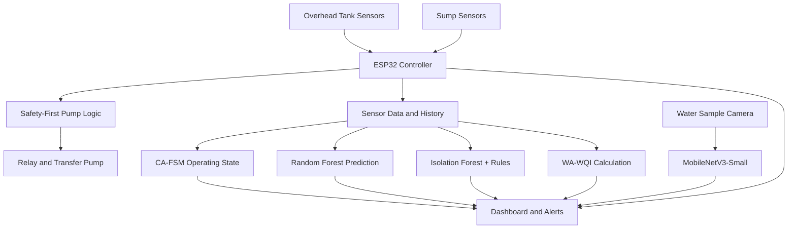

# AquaSense — Smart Water Tank Monitoring & Management

**An AIoT-based water monitoring, pump management, prediction, and water-quality screening system.**

## Overview

AquaSense is a low-cost smart water management system built around the ESP32. It monitors an overhead water tank (OHT) and a sump, automates water transfer using deterministic pump-control logic, and analyzes sensor history to identify operating conditions, predict future tank levels, and detect abnormal behaviour.

The system combines embedded sensing, IoT connectivity, machine learning, water-quality screening, and a browser-based dashboard in a modular architecture designed for a student-scale prototype.

## Key Features

- **Dual-reservoir monitoring:** Tracks overhead tank and sump water levels.
- **Automatic pump control:** Uses configurable level thresholds and hysteresis.
- **Dry-run protection:** Prevents pump operation when the sump water level is critically low.
- **Water availability indication:** Uses sump-level trends to infer incoming municipal-water availability.
- **Tank volume estimation:** Accounts for the documented tank geometry.
- **CA-FSM:** Classifies operating conditions using water-level trends and pump status.
- **Random Forest regression:** Predicts future overhead tank water levels using historical and current features.
- **Anomaly detection:** Combines Isolation Forest with engineering rules to flag unusual behaviour.
- **Water-quality screening:** Calculates a Weighted Arithmetic Water Quality Index (WA-WQI) using pH, TDS, and turbidity.
- **Visible-algae screening:** Uses MobileNetV3-Small to classify water images as `ALGAE_PRESENT` or `NO_VISIBLE_ALGAE`.
- **Monitoring dashboard:** Presents sensor readings, tank status, pump state, predictions, anomalies, water-quality indicators, and historical trends.

## System Architecture

The ESP32 handles sensing and time-critical pump safety. Analytical models generate supplementary predictions and alerts. The dashboard combines these outputs for monitoring and decision support.

## Pump Control Logic

AquaSense uses hysteresis to avoid unnecessary relay switching.

| Condition | Pump action |
|---|---|
| OHT level ≤ 20% and sump level ≥ 20% | Turn ON |
| OHT level ≥ 90% | Turn OFF |
| Sump level < 20% | Disable pump for dry-run protection |
| OHT level between 20% and 90% | Maintain the previous pump state, subject to safety conditions |

**Safety priority:** Low-sump protection takes precedence over a request to start the pump. AI predictions and anomaly alerts do not override these deterministic safety conditions.

## Technology Stack

| Component | Technology |
|---|---|
| Microcontroller | ESP32 DOIT DEVKIT V1 |
| Firmware | C++ / Arduino framework |
| Embedded development | PlatformIO |
| Tank-level sensing | HC-SR04 ultrasonic sensor |
| Pump switching | Relay module |
| Water-quality sensing | pH, TDS, turbidity and temperature sensors |
| Operating-state analysis | Context-Aware Finite State Machine (CA-FSM) |
| Level prediction | Random Forest regression |
| Anomaly detection | Isolation Forest + engineering rules |
| Water-quality index | Weighted Arithmetic WQI |
| Image classification | MobileNetV3-Small |
| User interface | Browser-based monitoring dashboard |

The actual installed hardware and software components should be verified against the current build configuration.

## Hardware Connections

The following GPIO mapping is documented for the integrated configuration.

| Component | ESP32 GPIO |
|---|---:|
| HC-SR04 Trigger | GPIO 5 |
| HC-SR04 Echo | GPIO 18 |
| Relay control | GPIO 23 |
| Analog sump sensor | GPIO 33 |
| pH sensor | GPIO 34 |
| TDS sensor | GPIO 35 |
| Turbidity sensor | GPIO 32 |
| Temperature sensor | GPIO 4 |

**Electrical safety:** The HC-SR04 Echo output is typically 5 V, so use an appropriate voltage divider or level shifter before connecting it to the ESP32's 3.3 V GPIO. Verify the voltage and interface requirements of every sensor. Power the pump through a suitably rated driver or relay and an appropriate supply, not directly from an ESP32 GPIO.

## Software Modules

### 1. Tank and Sump Monitoring
Converts sensor readings into water-level percentages, estimated volume, level trends, and source-water availability indications.

### 2. Pump Management
Implements threshold-based hysteresis and sump dry-run protection. This module remains independent of machine-learning decisions.

### 3. CA-FSM
Uses level trends, pump state, and sump context to classify operating states, such as filling, draining, stable operation, and abnormal behaviour.

### 4. Random Forest Prediction
Uses current and historical measurements and derived features to estimate future OHT water levels. Predictions are intended for monitoring and planning rather than direct actuator control.

### 5. Anomaly Detection
Combines Isolation Forest with engineering rules to identify unusual sensor relationships or operating patterns. An anomaly is a warning for investigation, not a definitive diagnosis.

### 6. WA-WQI
Combines pH, TDS, and turbidity into a water-quality screening indicator. Temperature is retained as contextual information rather than silently included in the index.

### 7. Visible-Algae Classification
Processes RGB water-sample images with MobileNetV3-Small and returns an algae-class prediction and confidence score. This module screens for visible algae only; it does not establish overall water safety.

### 8. Dashboard
Brings together live readings, historical graphs, pump status, operating states, predictions, anomalies, water-quality results, and visual-screening outputs.

## Dataset Strategy

| Dataset | Purpose |
|---|---|
| Sensor time series | Train and evaluate future water-level prediction |
| Operating-state records | Validate CA-FSM classifications |
| Normal and abnormal operating scenarios | Evaluate anomaly detection |
| pH, TDS and turbidity measurements | Calculate and validate WA-WQI |
| `ALGAE_PRESENT` and `NO_VISIBLE_ALGAE` images | Train and evaluate visible-algae classification |

For time-series models, use chronological training and test splits to reduce data leakage. For image classification, a proposed split is 70% training, 15% validation, and 15% testing. Record data provenance and evaluate models on representative, independently collected samples.

## Getting Started

### Prerequisites

- VS Code
- PlatformIO extension
- ESP32 board support
- USB data cable and ESP32 development board
- Configured sensors and relay hardware
- Python environment for the machine-learning components, where applicable
- A compatible browser for the dashboard

### Firmware Setup

1. Open the ESP32 firmware project in VS Code.
2. Review `platformio.ini` and verify the selected board and framework.
3. Check the GPIO assignments and sensor calibration values against the actual wiring.
4. Configure Wi-Fi credentials using the project's existing configuration method.
5. Connect the ESP32 and select the correct serial port.
6. Build and upload the firmware using PlatformIO.
7. Open the serial monitor and verify sensor readings, connectivity, and pump-control behaviour.

### Dashboard Setup

Follow the instructions for the actual dashboard implementation in the repository. If the dashboard is served directly by the ESP32, connect the board to Wi-Fi, obtain its IP address from the serial monitor, and open that address in a browser on the same network.

If the dashboard uses a separate frontend or backend, configure and launch those components according to their respective project files.

> **Note:** Exact dashboard commands, Python dependencies, environment variables, and repository paths should be added after verifying the current source tree. Do not assume a backend framework or database that is not present in the repository.

## Evaluation

The system should be evaluated at both the hardware and model levels.

- **Water-level monitoring:** Measurement error against known water levels.
- **Pump control:** Correct switching thresholds, hysteresis, and dry-run protection.
- **Random Forest:** MAE, RMSE, and R².
- **Anomaly detection:** Precision, recall, F1-score, false-positive rate, and detection latency.
- **WA-WQI:** Formula verification and comparison with reference measurements.
- **Algae classification:** Accuracy, precision, recall, F1-score, ROC-AUC, and confusion matrix.

Report measured results separately from expected outcomes. Model performance should not be claimed without completed experiments and recorded results.

## Limitations

- Ultrasonic readings can be affected by surface turbulence, condensation, and sensor placement.
- Tank geometry and calibration influence volume estimates.
- Sump-level trends indicate possible incoming water availability; they do not directly measure municipal pipeline flow.
- Prediction and anomaly detection depend on the quality and coverage of historical data.
- WA-WQI is a screening indicator, not laboratory certification.
- Visible-algae classification does not detect all contaminants or prove that water is safe to drink.
- Laboratory-scale performance may not generalize directly to full-sized household installations.

## Future Work

- Collect longer-duration datasets under varied operating conditions.
- Validate prediction and anomaly-detection performance on independent data.
- Test calibration across different tank geometries.
- Expand image datasets and evaluate performance under different lighting conditions.
- Investigate efficient edge deployment and mobile monitoring.
- Compare water-quality estimates against appropriate laboratory measurements.

## Project Status

AquaSense is a modular AIoT prototype intended to integrate water-quantity monitoring, source availability, pump safety, temporal analysis, prediction, anomaly detection, water-quality screening, and visual-algae screening.

The implementation status of each feature, particularly the camera model and trained datasets, should be reported according to the latest verified build and evaluation results.

---

**AquaSense — Smarter water monitoring through sensing, safety, and AI-assisted analysis.**
